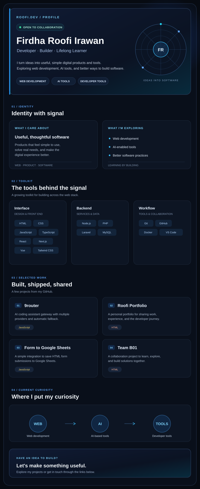

  

  <a href="https://github.com/roofi-dev/9router">9router</a> ·
  <a href="https://roofi.dev">Portfolio</a> ·
  <a href="https://github.com/roofi-dev/form-to-google-sheets">Form to Google Sheets</a> ·
  <a href="https://github.com/roofi-dev/team_B01">Team B01</a>

## Live GitHub activity

  

  
  

  <a href="https://github.com/roofi-dev">GitHub</a> ·
  <a href="https://github.com/roofi-dev?tab=repositories">All projects</a> ·
  <a href="https://roofi.dev">Portfolio</a>

  
Profile text version

  Saya senang mengubah ide menjadi produk digital yang berguna, sederhana, dan menyenangkan untuk digunakan. Saat ini saya mengeksplorasi pengembangan web, tools berbasis AI, dan praktik terbaik dalam membangun software.

  Saat ini saya membangun project web dan developer tools, terus belajar JavaScript, web development, dan AI, serta terbuka untuk kolaborasi pada project yang berdampak.

  Tech stack: HTML, CSS, JavaScript, TypeScript, React, Next.js, Vue, Node.js, PHP, Laravel, Tailwind CSS, MySQL, Git, GitHub, Docker, and VS Code.

